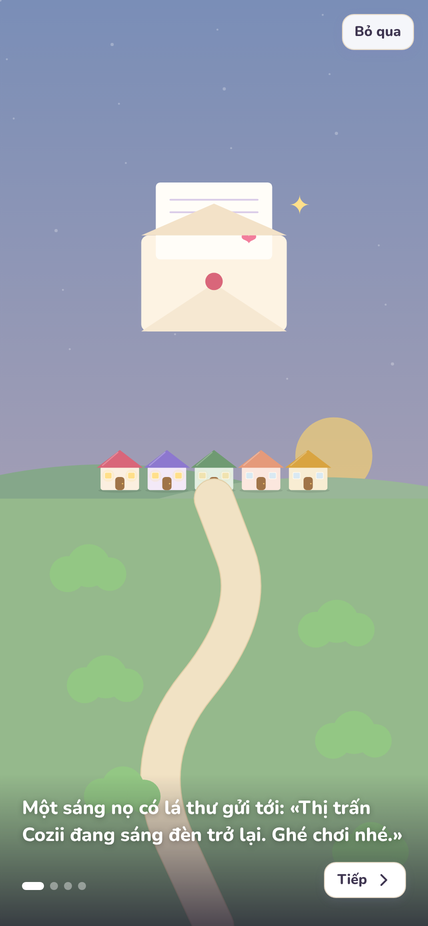
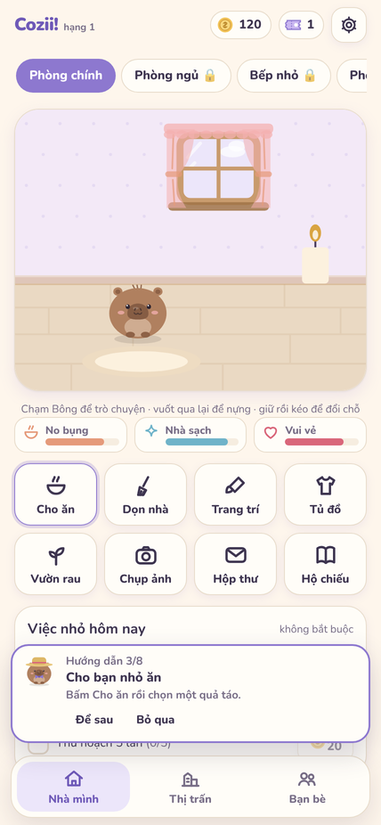
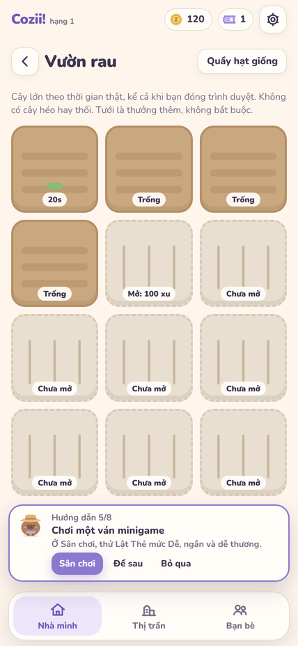
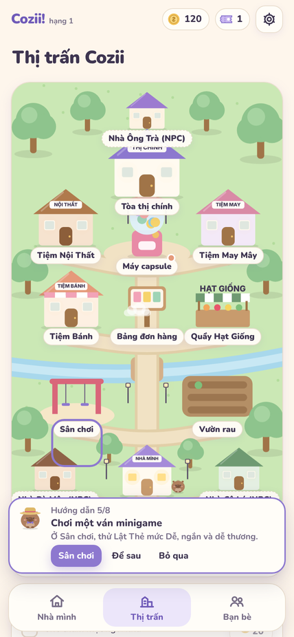
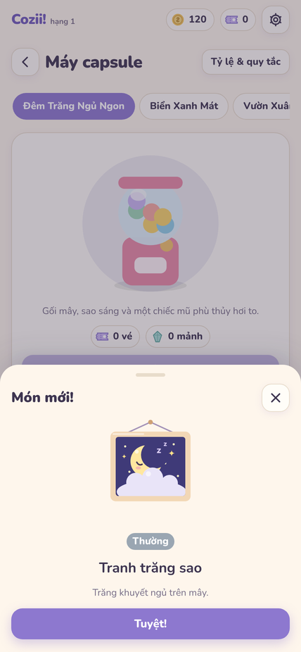
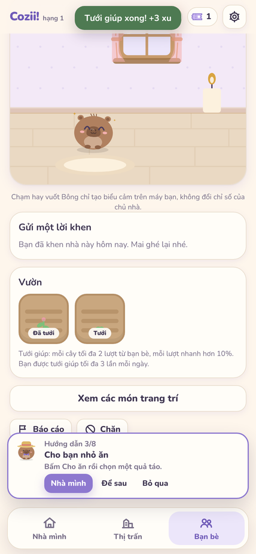
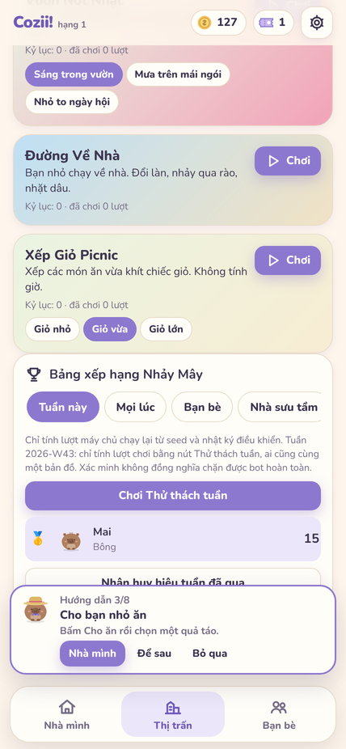
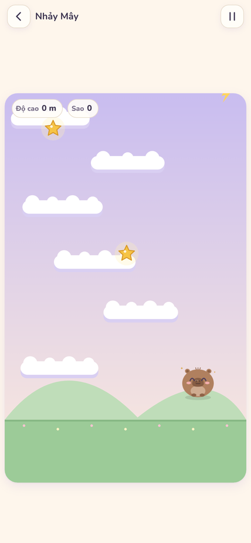

# Cozii! — Thị trấn Bạn Nhỏ (bản web)

Game web chơi trên điện thoại và máy tính, không cần App Store: chăm bạn nhỏ, làm vườn, 6 minigame, sưu tầm capsule,
trang trí nhà và **ghé thăm nhà bạn bè**. Dùng lại hình vẽ pet, lông, trang phục, nội thất, phòng và hiệu ứng của app
iOS Cozyday (chuyển từ SwiftUI sang Canvas 2D). App Swift ở thư mục gốc vẫn độc lập, không bị đụng tới.

* Toàn bộ mã web nằm trong `web/cozii/`. Đổi file ở đây không kích hoạt workflow build IPA (workflow đó chỉ theo dõi
  `Cozyday/**`, `Tests/**`, `project.yml`, `scripts/ci/**`).
* Tài liệu kinh tế & phần thưởng: [`docs/ECONOMY_VI.md`](docs/ECONOMY_VI.md).

## Hai chế độ chơi

| | Chơi trên máy (mặc định khi chưa cấu hình máy chủ) | Online (Supabase + hàm máy chủ) |
|---|---|---|
| Tài khoản | không | khách (ẩn danh) hoặc email bằng mã 6 số; khách nâng cấp lên email giữ nguyên tiến độ |
| Lưu ở đâu | `localStorage` của trình duyệt (có xuất/khôi phục file) | Postgres; mỗi thao tác qua `/api/cozii`, có mã chống trùng |
| Bạn bè, thăm nhà, bảng xếp hạng | không (vẫn ghé nhà mẫu NPC) | có |
| Phần thưởng có được máy chủ xác minh | không | có |

Ngoại tuyến ở chế độ online: vẫn mở được game (service worker), xem bản lưu gần nhất, thử đồ, chơi minigame luyện tập;
thao tác ảnh hưởng xu/kho đồ được giữ lại và gửi lại đúng mã yêu cầu khi có mạng.

## Kiến trúc

```
web/cozii
├─ src/core/        luật chơi thuần (engine.ts, games.ts, state.ts, tutorial.ts) — dùng chung client + máy chủ
├─ src/content/     số liệu: kinh tế, cây trồng, đồ, capsule, thị trấn, NPC
├─ src/games/       6 minigame (logic thuần, test được); Nhảy Mây dùng số nguyên để máy chủ chạy lại
├─ src/art/         hình vẽ chuyển từ Swift (pet, phòng, đồ, minigame)
├─ src/ui, src/app  giao diện React, router hash, PWA, âm thanh
├─ src/backend/     LocalBackend (chơi trên máy) và SupabaseBackend (gọi /api/cozii)
├─ server/          hàm máy chủ: xác thực token Supabase, giao dịch Postgres, bạn bè, thăm nhà, bảng xếp hạng
├─ api/cozii.js     server/ đóng gói bằng esbuild (SINH TỰ ĐỘNG, có test kiểm tra luôn khớp nguồn)
└─ supabase/migrations/  lược đồ `cozii` + RLS
```

Bảo mật: trình duyệt chỉ có **publishable/anon key** để đăng nhập. Schema `cozii` không mở cho API REST của Supabase
(RLS bật, không có policy, thu hồi quyền của `anon`/`authenticated`). Chỉ hàm `/api/cozii` đọc/ghi qua `DATABASE_URL`
(biến bí mật trên Vercel), sau khi kiểm tra token người dùng với Supabase Auth. Không có service-role key nào trong
frontend; người dùng không tự ghi được xu, phần thưởng hay điểm.

## Chạy trên máy

Cần Node 20+.

```bash
cd web/cozii
npm install
npm run dev            # chế độ chơi trên máy, http://localhost:5173
```

Chạy thử chế độ online hoàn toàn trên máy (Postgres cục bộ, tài khoản dev giả — **chỉ cho phát triển**, tự tắt khi
chạy trên Vercel hoặc `NODE_ENV=production`):

```bash
npm run dev:online     # cần PostgreSQL 14+ cài sẵn (initdb/pg_ctl/psql); tạo DB cozii_dev ở cổng 54329
```

## Kiểm tra

```bash
npm run typecheck
npm test                       # luật chơi, minigame, hướng dẫn, gói api/cozii.js khớp nguồn
TEST_DATABASE_URL=$(bash scripts/dev/pg-local.sh) npm run test:server   # máy chủ trên Postgres thật
npm run sim:economy            # bảng mô phỏng kinh tế 30 ngày
npm run build                  # bản production vào dist/
```

`test:server` gồm: tạo tài khoản, gửi lại cùng mã yêu cầu, hai tab mua cùng lúc (không âm, không trùng), thu hoạch đồng
thời chỉ một lần, capsule thử lại ra đúng kết quả cũ, bạn bè/riêng tư/chặn được thực thi ở máy chủ, ảnh chụp nhà không lộ
xu/email/kho đồ, khen và tưới giúp có hạn mức (kể cả gửi đồng thời), bảng xếp hạng chạy lại lượt chơi, chặn nộp nhanh hơn
thời gian thật và nộp hai lần, khách không lên bảng công khai.

Kiểm tra trong trình duyệt (Chromium, `node scripts/dev/flow.mjs <kịch-bản>` khi `npm run dev` đang chạy ở cổng 5199):
`tour` (cốt truyện → nhà → vườn → thị trấn → capsule → minigame → hộ chiếu → ảnh), `games` (6 minigame), `pause` (chuyển
nền tự tạm dừng; chơi lại 3 lần đồng hồ game vẫn đúng tốc độ), và `scripts/dev/online-flow.mjs` (hai người chơi: kết bạn,
đăng nhà, thăm, khen, tưới giúp, hộp thư, Thử thách tuần, bảng xếp hạng — cần `npm run dev:online -- --port 5199`).

## Triển khai (Vercel + Supabase, gói miễn phí)

### 1. Supabase

1. Tạo project ở <https://supabase.com/dashboard> (chọn vùng gần người chơi, ví dụ Singapore).
2. **SQL Editor** → dán toàn bộ `supabase/migrations/20261020000000_cozii_schema.sql` → Run. (Hoặc dùng Supabase CLI:
   `supabase link` rồi `supabase db push`.) Không chạy `supabase/tests/bootstrap-local.sql` trên project thật — file đó
   chỉ giả lập bảng `auth.users` cho test cục bộ.
3. **Authentication → Sign In / Providers**:
   * bật **Allow anonymous sign-ins** (chơi khách);
   * bật **Allow manual linking** (Supabase yêu cầu khi nâng cấp tài khoản khách lên email);
   * nhà cung cấp **Email** bật sẵn. Game đăng nhập bằng **mã 6 số**, nên vào **Authentication → Emails → Templates**:
     trong mẫu **Magic Link** và **Change Email Address**, thêm `{{ .Token }}` vào nội dung thư (ví dụ
     `Mã đăng nhập Cozii! của bạn: {{ .Token }}`).
   * Supabase giới hạn số thư gửi bằng máy chủ thư mặc định (vài thư mỗi giờ). Khi có nhiều người chơi, cấu hình SMTP
     riêng ở **Authentication → Emails → SMTP Settings**.
4. **Authentication → URL Configuration**: **Site URL** = địa chỉ Vercel của bạn (ví dụ `https://cozii.vercel.app`);
   thêm cùng địa chỉ (và `http://localhost:5173` nếu thử trên máy) vào **Redirect URLs**.
5. Lấy thông tin ở nút **Connect** / **Project Settings → API Keys**:
   * Project URL → `VITE_SUPABASE_URL`
   * Publishable key (`sb_publishable_…`, hoặc anon key kiểu cũ) → `VITE_SUPABASE_PUBLISHABLE_KEY`
   * **Transaction pooler** connection string (cổng 6543), thay `[YOUR-PASSWORD]` → `DATABASE_URL`
   * **Không** dùng secret key / service_role ở đâu cả.
6. (Tùy chọn) Dọn tài khoản khách bỏ hoang: chạy định kỳ trong SQL Editor (hoặc pg_cron)
   `delete from auth.users where is_anonymous is true and created_at < now() - interval '30 days';`
   Dữ liệu `cozii.*` của tài khoản đó bị xóa theo (on delete cascade).

### 2. Vercel

1. <https://vercel.com/new> → Import repo GitHub này (repo private vẫn import được, không cần đổi sang public).
2. **Root Directory**: `web/cozii`. Framework: Vite (đã khai báo trong `vercel.json`).
   Build Command `npm run build`, Output Directory `dist`, Install Command `npm ci` — đều đã có trong `vercel.json`.
3. **Environment Variables** (Production và Preview):

   | Tên | Giá trị | Bí mật? |
   |---|---|---|
   | `VITE_SUPABASE_URL` | Project URL | không (nhúng vào bản build) |
   | `VITE_SUPABASE_PUBLISHABLE_KEY` | publishable/anon key | không |
   | `DATABASE_URL` | transaction pooler URI | **có** — đừng đặt tiền tố `VITE_` |
   | `DATABASE_CA` | (tùy chọn) nội dung PEM chứng chỉ CA của Supabase để kiểm tra TLS chặt | có |

4. Deploy. Hàm máy chủ là `api/cozii.js` (Node.js, tối đa 15 giây/lần gọi). `vercel.json` có `ignoreCommand` để bỏ qua
   build khi commit không đổi gì trong `web/cozii`.
5. Mở địa chỉ Vercel trên điện thoại → Safari: **Chia sẻ → Thêm vào Màn hình chính** để chơi như app (PWA).

Không cấu hình Supabase thì bản Vercel vẫn chạy ở chế độ chơi trên máy.

## Ảnh chụp

Chụp tự động bằng Chromium (khung 428 × 926, giống iPhone 12 Pro Max) với `scripts/dev/flow.mjs` và
`scripts/dev/online-flow.mjs`, lưu trong [`docs/screenshots`](docs/screenshots).

* Ảnh 01–14 và 20–25: chế độ chơi thật, người chơi mới (dữ liệu tạo ra trong lúc chụp).
* Ảnh 15–19 (`online-…`): **môi trường demo cục bộ** — hai tài khoản dev giả (`npm run dev:online`) trên Postgres của máy
  phát triển, chạy đúng mã máy chủ `server/`. Không phải ảnh từ bản đã triển khai và không có dữ liệu thật của ai.

| | | | |
|---|---|---|---|
|  |  |  |  |
|  |  |  |  |

## Giới hạn đã biết

* Chưa kiểm thử trên Safari/WebKit thật (môi trường phát triển chỉ có Chromium). Đã tránh API không có trên Safari, nhưng
  cần thử trên iPhone trước khi phát hành rộng. Không đo/không hứa 60 fps.
* Dữ liệu chế độ chơi trên máy có thể mất khi xóa dữ liệu trình duyệt; Safari có thể xóa dữ liệu web không được dùng
  khoảng 7 ngày (trừ khi đã thêm vào Màn hình chính). Hãy dùng Xuất sao lưu hoặc tài khoản online.
* Xác minh bảng xếp hạng (chạy lại lượt chơi) làm gian lận khó hơn nhưng không chặn hoàn toàn bot chơi hộ.
* Không có CAPTCHA cho đăng nhập khách: Supabase có giới hạn tốc độ theo IP cho đăng nhập ẩn danh. Muốn thêm
  Turnstile/hCaptcha cần sửa `signInAnonymously`/`signInWithOtp` để gửi `captchaToken`.
* Không có thông báo đẩy khi cây chín (game không chạy nền).
* Gói Hobby của Vercel dành cho dự án cá nhân, phi thương mại; gói miễn phí của Supabase tạm dừng project sau một thời gian
  không hoạt động.
